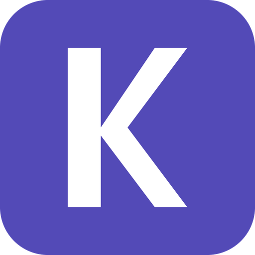

# KissMySkills for Claude Code and Cursor

2,500+ ready-made AI skills, agents and prompt packs, plus an AI CRM board, inside your coding agent. Ask for a specialist by name and it loads into the chat: an SEO specialist, a copywriter, a recruiter, a contract reviewer, a sales coach and many more.

## Install

**Claude Code** (one command in your terminal):

```bash
claude plugin install kissmyskills --marketplace Kreal-51/kissmyskills-plugin
```

Or inside a Claude Code session:

```text
/plugin marketplace add Kreal-51/kissmyskills-plugin
/plugin install kissmyskills@kissmyskills
```

Then type `/mcp`, pick `kissmyskills`, choose **Authenticate** and sign in with your email (6-digit code) or Google.

**Cursor**: install KissMySkills from the Cursor Marketplace, then open **Cursor Settings > MCP** and click **Connect** next to `kissmyskills`. Without the marketplace, add this to `~/.cursor/mcp.json`:

```json
{"mcpServers":{"kissmyskills":{"url":"https://mcp.kissmyskills.com/mcp"}}}
```

## What you get

- **The KissMySkills MCP server** (`https://mcp.kissmyskills.com/mcp`, streamable HTTP, OAuth sign-in) with tools such as `search_skills`, `suggest_skills`, `get_skill`, `list_collection`, `my_plan` and the `crm_*` board tools.
- **A `kissmyskills` skill** that teaches the agent how to use the connector: find a skill and load it in the same turn, treat "KMS, ..." as "use the connector", read the board before answering "where were we?".
- **Slash commands**:
  - `/kms-find <task>` - find the best skill for a task and load it.
  - `/kms-crm-today` - what is on your board today: overdue, due, next steps.
  - `/kms-plan` - your plan, trial days left and what is unlocked.

In Claude Code the commands are namespaced as `/kissmyskills:kms-find` and so on.

## Try it

```text
KMS, load the SEO specialist
KMS, find a skill to write a cold email sequence
KMS, where were we?
```

## Free trial and pricing

Any email starts a **7-day free trial** with full access, no card. After that, plans start at $9 a month. The AI CRM is free forever up to 1,000 cards. Details: https://kissmyskills.com/pages/connector

## What this plugin sends and where

The plugin itself contains no code, only configuration and instructions. It registers one remote MCP server, `https://mcp.kissmyskills.com/mcp`, operated by KissMySkills. When the agent calls a KissMySkills tool, the tool arguments (for example search keywords, or the CRM records you ask it to create) are sent to that server. Sign-in uses OAuth in your browser; the plugin stores no credentials and asks for no API keys. Nothing is sent anywhere else.

- Privacy policy: https://kissmyskills.com/policies/privacy-policy
- Terms of service: https://kissmyskills.com/policies/terms-of-service
- Support: hello@kissmyskills.com or https://kissmyskills.com/pages/contact

## License

The plugin wrapper in this repository is MIT licensed (see `LICENSE`). The KissMySkills service and its skill catalog are covered by the terms of service above.
