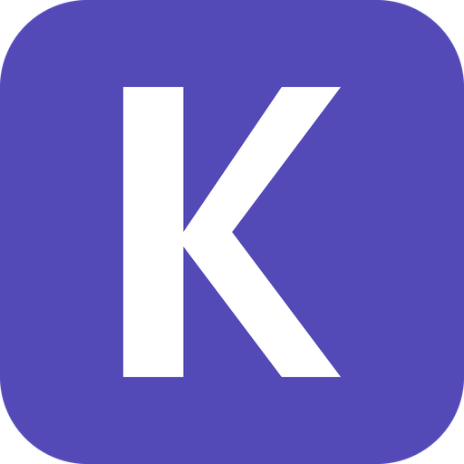

# KissMySkills for Claude Code and Cursor

2,500+ ready-made AI skills, agents and prompt packs, plus an AI CRM board, inside your coding agent. Ask for a specialist by name and it loads into the chat: an SEO specialist, a copywriter, a recruiter, a contract reviewer, a sales coach and many more.

## Install

**Claude Code** (one command in your terminal):

```bash
claude plugin install kissmyskills --marketplace Kreal-51/kissmyskills-plugin
```

Or inside a Claude Code session:

```text
/plugin marketplace add Kreal-51/kissmyskills-plugin
/plugin install kissmyskills@kissmyskills
```

Then type `/mcp`, pick `kissmyskills`, choose **Authenticate** and sign in with your email (6-digit code) or Google.

**Cursor**: install KissMySkills from the Cursor Marketplace, then open **Cursor Settings > MCP** and click **Connect** next to `kissmyskills`. Without the marketplace, add this to `~/.cursor/mcp.json`:

```json
{"mcpServers":{"kissmyskills":{"url":"https://mcp.kissmyskills.com/mcp"}}}
```

## What you get

- **The KissMySkills MCP server** (`https://mcp.kissmyskills.com/mcp`, streamable HTTP, OAuth sign-in) with tools such as `search_skills`, `suggest_skills`, `get_skill`, `list_collection`, `my_plan` and the `crm_*` board tools.
- **A `kissmyskills` skill** that teaches the agent how to use the connector: find a skill and load it in the same turn, treat "KMS, ..." as "use the connector", read the board before answering "where were we?".
- **Slash commands**:
  - `/kms-find <task>` - find the best skill for a task and load it.
  - `/kms-crm-today` - what is on your board today: overdue, due, next steps.
  - `/kms-plan` - your plan, trial days left and what is unlocked.
  - `/kms-sync-skills` - install your own and team skills into Claude Code as real skills (see below).

In Claude Code the commands are namespaced as `/kissmyskills:kms-find` and so on.

## Try it

```text
KMS, load the SEO specialist
KMS, find a skill to write a cold email sequence
KMS, where were we?
```

## Sync your own and team skills

Skills you upload at https://app.kissmyskills.com (My skills), and skills your team shares with a workspace you are in, work through the connector in any chat. In Claude Code you can also install them as regular skills, so they trigger on their description and their files (`scripts/*.py`, `ref/*.md` ...) are on disk:

```text
/kissmyskills:kms-sync-skills
```

- The agent calls the connector tool `my_skills_sync`, which returns a sync link valid for 10 minutes, and runs `scripts/sync-skills.mjs` with it (Node 18+, no dependencies).
- Each skill goes to `~/.claude/skills/<handle>/` (`SKILL.md` + all its files). Handles start with `my-`, for example `my-release-checklist-0a1b2c`. Use `/kissmyskills:kms-sync-skills --project` for this project's `.claude/skills` instead, and `--dry-run` to see what would change.
- Run it again whenever your skills change: changed skills are replaced, unchanged ones are left alone, and skills you no longer see (deleted, unshared, or you left the workspace) are removed.
- Safety: the script downloads only from `mcp.kissmyskills.com`, refuses file paths with `..` or absolute paths, writes plain text files and never runs them. It replaces or removes only folders it created (marked with `.kms-sync.json`); your other skills, including any folder you made yourself, are never touched. Edits you make inside a synced folder are overwritten on the next sync: change the skill in the dashboard instead.
- By hand: ask the agent for `my_skills_sync`, then `node scripts/sync-skills.mjs "<link>" [--dir <skills folder>] [--dry-run]`.

Cursor has no skills folder of this kind; there the skills load through the connector (`get_skill`).

## Free trial and pricing

Any email starts a **7-day free trial** with full access, no card. After that, plans start at $9 a month. The AI CRM is free forever up to 1,000 cards. Details: https://kissmyskills.com/pages/connector

## What this plugin sends and where

The plugin is configuration and instructions plus one small script, `scripts/sync-skills.mjs`, which runs only when you use `/kms-sync-skills`. It registers one remote MCP server, `https://mcp.kissmyskills.com/mcp`, operated by KissMySkills. When the agent calls a KissMySkills tool, the tool arguments (for example search keywords, or the CRM records you ask it to create) are sent to that server. The sync script only downloads (your own and team skills, from `https://mcp.kissmyskills.com/skills-sync/v1/...` with the short-lived link) and writes them to your skills folder; it sends nothing. Sign-in uses OAuth in your browser; the plugin stores no credentials and asks for no API keys. Nothing is sent anywhere else.

- Privacy policy: https://kissmyskills.com/policies/privacy-policy
- Terms of service: https://kissmyskills.com/policies/terms-of-service
- Support: hello@kissmyskills.com or https://kissmyskills.com/pages/contact

## License

The plugin wrapper in this repository is MIT licensed (see `LICENSE`). The KissMySkills service and its skill catalog are covered by the terms of service above.
